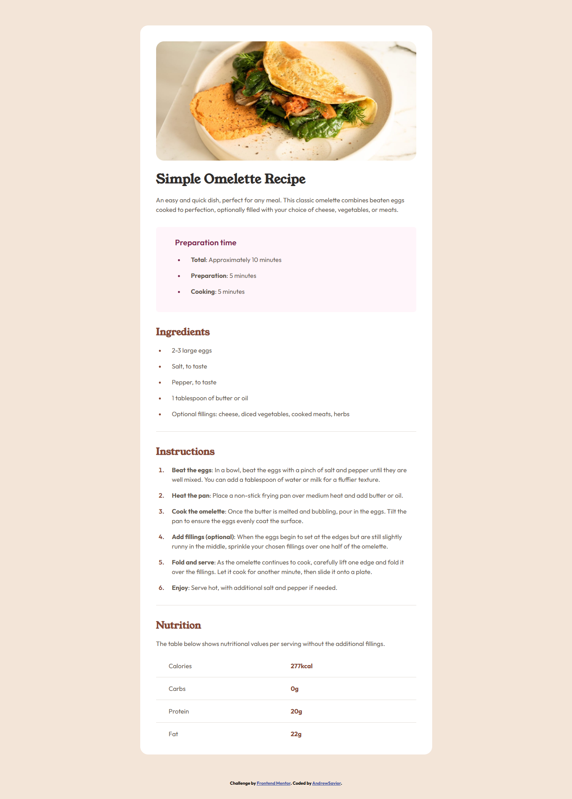
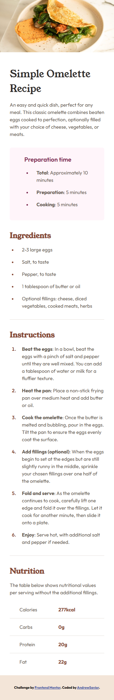
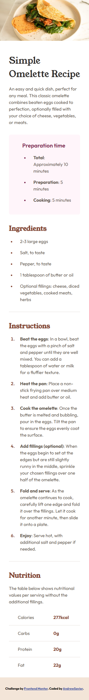

# Frontend Mentor - Recipe page solution

This is a solution to the [Recipe page challenge on Frontend Mentor](https://www.frontendmentor.io/challenges/recipe-page-KiTsR8QQKm). Frontend Mentor challenges help you improve your coding skills by building realistic projects.

## Table of contents

- [Overview](#overview)
  - [The challenge](#the-challenge)
  - [Screenshot](#screenshot)
  - [Links](#links)
- [My process](#my-process)
  - [Built with](#built-with)
  - [What I learned](#what-i-learned)
  - [Continued development](#continued-development)
  - [Useful resources](#useful-resources)
  - [AI Collaboration](#ai-collaboration)
- [Author](#author)
- [Acknowledgments](#acknowledgments)

**Note: Delete this note and update the table of contents based on what sections you keep.**

## Overview

### Screenshot

1.Desktop Design:

2.Mobile 375px:

3.Mobile 320px:

### Links

- Solution URL: [https://github.com/HauviG/recipe-page](https://github.com/HauviG/recipe-page)
- Live Site URL: [https://hauvig.github.io/recipe-page/](https://hauvig.github.io/recipe-page/)

## My process

### Built with

- Semantic HTML5 markup
- CSS custom properties
- Flexbox

### What I learned

Just Practice.

## Author

- Website - [AndrewSavior](https://github.com/HauviG?tab=repositories)
- Frontend Mentor - [@HauviG](https://www.frontendmentor.io/profile/HauviG)
